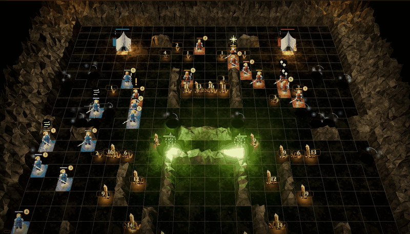
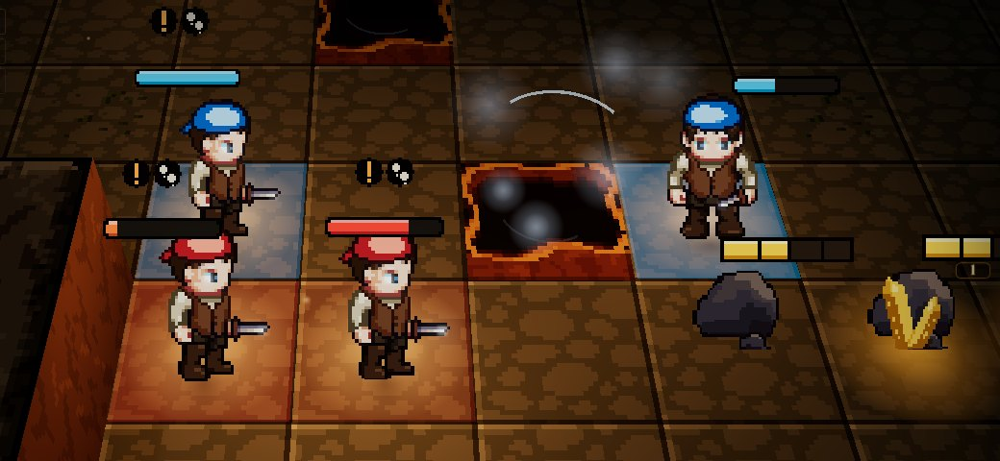

# 웜퍼스 워즈 (Wumpus Wars)

> **엔진 버전 1.0.1 · 2026-11-27 동결.** 이 뒤로 규칙 · 엔진 · 맵 생성기는 바뀌지 않는다. (1.0.1: 봇 import 보안 수정, 모험가 차례를 두 팀이 번갈아 하도록 바꿈. [바뀐 점](#101-에서-바뀐-점)) 내 엔진이 같은지는 `python -m wumpus --version` 으로 확인한다.

인공지능개론 배틀코드형 과제 게임이다. 수업의 **웜퍼스 월드 (Wumpus World)** 를 두 팀 대전으로 옮겼다. 학생은 **봇 코드**만 짠다. 경기 중에 사람은 아무것도 하지 않고, 봇의 판단만으로 승부가 난다.



> **처음이라면 → [웜퍼스 워즈 쉽게 보기](docs/EASY.md)** (움직이는 그림 4개와 실제로 돌아가는 최소 봇으로 보는 A4 두 쪽 설명. 인쇄용: [easy.pdf](docs/pdf/easy.pdf))

## 한눈에 보는 규칙

- 두 원정대가 어두운 동굴에서 금을 캐 **야영지**에 바친다.
- 유닛은 검과 **화살 한 발**을 든 **모험가** 하나뿐이다 (값 20). 처음에는 모험가 없이 금고 20 만 있다. 한 턴에 **이동 · 검 · 화살 가운데 하나**. 검은 상하좌우 옆 칸, 화살은 일직선 끝까지.
- 모험가는 **자기 칸만 느낀다.** 구덩이 · 웜퍼스 · 금맥 · 적은 보이지 않는다. 지각을 기억하고 추론해서 알아낸다.
- **적 야영지의 위치도 알려 주지 않는다.** 맵은 좌우 · 상하 · 180° 회전 대칭 중 하나이므로, 적 야영지는 우리 야영지의 거울 칸 셋 가운데 하나다. 벽의 거울 칸과 열기로 후보를 지운다.
- **적 야영지를 부수면** 바로 이긴다. 못 부수면 **1000 라운드** 끝에 바친 금이 많은 쪽이 이긴다.
- 봇에는 **연산 한도** 가 있다: 유닛마다 한 차례에 연산 10,000 (첫 차례만 200,000, 쌓이지 않는다). 넘은 차례는 행동이 버려진다. 봇이 불러올 수 있는 모듈은 표준 라이브러리 몇 개로 정해져 있다.
- 웜퍼스는 교과서처럼 **화살로만** 쓰러진다. 굴에 들어가면 잡아먹힌다. 화살로 쓰러뜨린 모험가가 보물 30 을 든다.
- 들 수 있는 금은 **끝이 없다.** 적 모험가를 쓰러뜨리면 그가 든 금 + 3 을 빼앗는다. 구덩이 (맵의 약 12%) 에 빠지면 든 금도 사라진다.
- 금맥을 다 캐면 **다른 곳에** 새 금맥이 생겨 천천히 자란다.

모험가가 차례마다 자기 칸에서 느끼는 아홉 가지 (지각). 교과서의 다섯 (바람 · 악취 · 반짝임 · 부딪힘 · 비명) 에 두 팀 게임을 위한 넷을 더했다:

| 지각 | 뜻 | 추론 예 |
|---|---|---|
| 바람 | 상하좌우에 구덩이가 있다 | 바람이 없으면 옆 칸 넷은 구덩이가 아니다 |
| 악취 | 상하좌우에 웜퍼스 굴이 있다 | 악취가 없으면 옆 칸 넷은 굴이 아니다 |
| 반짝임 | 이 칸에 금맥 | 반짝이면 캔다 |
| 부딪힘 | 지난 이동이 막혔다 | 발소리도 없으면 그쪽은 벽이다 |
| 발소리 | 상하좌우의 다른 모험가 수 (팀 구분 없음) | 기억한 팀원 수보다 많으면 적이 옆에 있다 |
| 아픔 | 지난 차례 뒤 받은 피해 | 누군가 옆에서 쳤다 |
| 비명 | 쓰러진 웜퍼스 수 (맵 전체) | 누군가 웜퍼스를 잡았다 |
| 열기 | 상하좌우에 야영지 (어느 팀이든) | 우리 야영지 옆이 아니면 적 야영지가 옆에 있다 |
| 외침 | 쓰러진 모험가 수 (두 팀 모두, 맵 전체) | 우리 팀이 잃은 수를 빼면 적이 잃은 수 |



리플레이 뷰어는 모험가마다 **지금 느끼는 지각을 머리 위 아이콘**으로 띄운다 (발소리는 발밑 칸의 발자국). 위 그림의 등에 선 큰 화살은 남은 화살 한 발, 허리의 자루는 든 금이다. 동굴은 어둡고 모험가 발밑만 밝다. 봇이 아는 세상이 그만큼 좁기 때문이다.

## 수업과의 대응

| 이 게임 | 수업 (웜퍼스 월드) | 쓰게 되는 AI 기법 |
|---|---|---|
| 숨은 구덩이와 바람 | Pit · Breeze | 명제논리 추론, 지식 베이스 |
| 웜퍼스와 악취 · 금과 반짝임 | Wumpus · Stench · Glitter | 명제논리 추론, 모델 검사 |
| 벽과 부딪힘 · 웜퍼스의 비명 | Bump · Scream | 지각 기록, 믿음 갱신 |
| 모험가의 외침 | 지각 추론 | 셈과 기록으로 적이 잃은 수 · 내 칼의 결과 알아내기 |
| 자기 칸만 느끼는 모험가 | 부분 관측 | 믿음 상태, 탐사 |
| 보이지 않는 적 (발소리 · 아픔) | 지각 추론 | 가설 지우기, 팀 공유 지식 |
| 숨은 맵 대칭 · 적 야영지 · 열기 | 1차 술어 논리 | 대칭 후보 지우기 (벽의 거울 칸 · 열기), 적 야영지 찾기 |
| 금 캐기 · 길 찾기 | 탐색 | BFS · A* · 위험 비용 |
| 모험가 여럿에게 금맥 나누기 | CSP | 배정 · 제약 만족 |

## 바로 해 보기

Python 3.8 이상이면 된다 (연산 한도의 공식 셈은 3.12 이상 기준). 다른 설치는 없다 (표준 라이브러리만 쓴다).

```bash
git clone <이 저장소 주소> wumpus_wars
cd wumpus_wars

python -m wumpus new mybot                      # bots/mybot/main.py 를 만든다 (시작용 봇 복사)
python -m wumpus run mybot starter --open       # 경기 하나. 끝나면 브라우저에 리플레이가 열린다
python -m wumpus scrim mybot starter            # 맵 10개에서 양쪽 진영으로 겨루고 승패를 센다
```

`pip install -e .` 로 설치하면 `python -m wumpus` 대신 `wumpus` 만 써도 된다.

## 들어 있는 봇

봇은 **시작용 봇** (`bots/starter`) 과 **최소 봇** (`bots/mini`, 43줄. [쉽게 보기](docs/EASY.md) 5절) 이다. 시작용 봇은 복사해서 고쳐 쓰는 출발점이자, 처음 넘어야 할 상대다.

| 쓰는 것 | 시작용 봇이 하는 일 |
|---|---|
| 바람 · 악취 | 둘 다 없는 칸의 상하좌우는 안전하다고 보고, 안전한 칸을 넓히며 탐험한다 |
| 반짝임 | 캔다. 가득 차면 아는 길로 야영지에 돌아가 바친다 |
| 부딪힘 · 발소리 | 움직일 때 발소리가 없었는데 막히면 벽으로 기억한다. 다른 모험가에게 막히면 잠시 돌아간다 |
| 열기 · 맵 대칭 | 적 야영지 후보 (대칭 셋의 거울 칸) 를 지운다: 열기가 없으면 옆 칸은 야영지가 아니고, 벽의 거울 칸에 서 본 적이 있으면 그 대칭은 아니다 |
| 아픔 | 옆 칸을 차례로 쳐서 반격한다. 적 야영지 옆에서는 체력이 넉넉할 때 야영지를 친다 |
| 비명 | 악취를 느꼈던 칸에 다시 가서 웜퍼스가 사라졌는지 확인한다 |
| `memory` | 찾은 금맥의 위치를 팀과 나눈다. 바친 뒤에는 아는 금맥으로 돌아간다 |

일부러 남겨 둔 것은 파일 안의 `TODO` 에 적혀 있다 (구덩이 위치 추론, 적 위치 추론, 지운 대칭을 팀과 나누기, 외침으로 적이 잃은 수 세기, 야영지 공격 시점, 생산 계획).

미리 만든 리플레이는 [`demo/`](demo) 에 있다. `.html` 파일을 브라우저로 열면 된다.

| 파일 | 내용 |
|---|---|
| `demo/starter_vs_starter.html` | 시작용 봇끼리의 한 판 (맵 temple_gate). 1000 라운드 끝에 289 : 432. 화살 · 처치 금 · 새 금맥을 볼 수 있다 |

## 설명서

| 문서 | 내용 |
|---|---|
| [쉽게 보기](docs/EASY.md) | 움직이는 그림으로 보는 규칙 요약과 최소 봇 (A4 두 쪽) |
| [시작하기](docs/GETTING_STARTED.md) | 설치, 첫 경기, 내 봇 만들기, 고치고 시험하는 순서 |
| [게임 규칙](docs/RULES.md) | 목표 · 맵 · 모험가 · 아홉 지각 · 구덩이 · 웜퍼스 · 금 · 야영지 · 행동 · 차례 순서 · 코드 검사 · 모든 수치 |
| [봇 API](docs/API.md) | `turn(me, view, memory)`, 지각, 행동, 공유 메모리, 디버그 표시, 연산 한도 · 코드 검사 |
| [스크림 도구](docs/SCRIM.md) | 여러 맵 묶음 대전, 승률 · 시간 · 오류 보기, CSV |
| [토너먼트](docs/TOURNAMENT.md) | 학생 봇 전체로 스위스 예선 → 더블 일리미네이션 본선. 대진표 · 공개 범위 · 리플레이 · zip 묶기 (프로그램 화면) |
| [리플레이 도구](docs/REPLAY.md) | 리플레이 파일, 뷰어 화면, 지각 아이콘, 명장면 · 사건 알림 · 금 줄다리기, 팀 시야, .json 형식 |
| [맵](docs/MAPS.md) | 맵 목록 · 그림 보기 · 새 맵 만들기 · 맵 파일 형식 |

PDF 문서 (인쇄용, 학위논문 양식). 규칙서 · 가이드북은 `python -X utf8 tools/md2thesis.py all` 로 위 마크다운에서, 제안서는 `python -X utf8 tools/proposal.py` 로 다시 만든다.

| 문서 | 내용 |
|---|---|
| [쉽게 보기](docs/pdf/easy.pdf) | 규칙 요약 · 최소 봇 (2쪽, 움직이는 그림 대신 대표 장면) |
| [게임 규칙서](docs/pdf/rulebook.pdf) | 게임 규칙 전체, 그림, 수치 일람 (24쪽) |
| [봇 API 가이드북](docs/pdf/api_guidebook.pdf) | 시작하기 · 봇 API · 스크림 · 리플레이 · 맵 (31쪽) |
| [과제 제안서](docs/pdf/proposal.pdf) | 배틀코드형 과제 제안: 왜 배틀코드인가, 게임 소개, 개발 환경, 평가 방식 두 안 (25쪽) |

## 명령 한눈에

| 명령 | 하는 일 |
|---|---|
| `python -m wumpus run 봇A 봇B [--map 맵] [--open]` | 경기 하나 + 리플레이 (`replays/`) |
| `python -m wumpus scrim 봇A 봇B [--maps all] [--seeds 1-3]` | 여러 맵에서 양쪽 진영으로 겨루고 승패표 |
| `python -m wumpus view 리플레이.json` | 리플레이를 뷰어로 연다 |
| `python -m wumpus viewer` | 빈 뷰어 (json 을 끌어다 놓아 연다) |
| `python -m wumpus maps [list / show 맵 / gen]` | 맵 목록 · 글자 그림 · 새 맵 |
| `python -m wumpus new 이름` | 새 봇 폴더 |
| `python -m wumpus check 봇` | 봇 점검 (코드 검사 · 오류 · 차례 시간 · 연산) |
| `python -m wumpus tournament` | 토너먼트 프로그램 (Windows 는 `tournament.bat` 더블클릭) |

`run` · `scrim` · `check` 에 `--no-ops-limit` 를 붙이면 연산 셈을 꺼서 빠르게 돌린다 (공식 규칙은 아니다).

## 저장소 구성

```
wumpus/            게임 패키지
  api.py           봇이 쓰는 API 와 규칙 수치
  ops.py           연산 계량기 (봇 코드가 한 일의 양 세기)
  guard.py         제출 코드 검사 (엔진 속에 닿는 코드를 막는다)
  engine.py        게임 엔진 (같은 봇 · 맵 · 시드면 같은 결과)
  maps.py          대칭 맵 생성기, 맵 파일 읽기 · 쓰기
  replay.py        리플레이 저장, 뷰어 html 만들기
  cli.py           명령줄 도구 (run · scrim · view · maps · new · check)
  viewer/          리플레이 뷰어 (viewer.html, 3D 화면 view3d.js, 그림 sprites/, three.js 묶음 vendor/)
bots/              starter (시작용 봇), mini (최소 봇). 자기 봇도 여기에 만든다
maps/              맵 10개 (*.json)
demo/              미리 만든 리플레이
docs/              설명서, 그림 (images/), PDF (pdf/)
tools/             PDF 조판 (md2thesis.py · proposal.py · thesis.py), 그림 합성 (lpc_build.py), 대표 GIF (hero_gif.py), 쉽게 보기 그림 · PDF (easy_gifs.py · easy_pdf.py)
tests/             기본 점검 (python -m unittest discover tests)
```

## 1.0.1 에서 바뀐 점

- **보안:** `from wumpus import engine` 처럼 `wumpus` 에서 `api` 밖의 것을 불러오면, 봇이 엔진 속과 컴퓨터의 파일에 닿을 수 있었다. 코드 검사와 실행 단계 모두에서 막는다 (코드 검사에 걸리면 실격). `from wumpus.api import ...` 는 그대로 된다.
- **차례 순서:** 모험가가 번호 순서로만 움직이면 1 라운드에 먼저 뽑힌 붉은 첫 모험가가 경기 내내 먼저 움직였다. 이제 두 팀이 번갈아 움직이고, 먼저 움직이는 팀이 라운드마다 바뀐다 ([규칙 10절](docs/RULES.md)). 같은 봇 · 맵 · 시드의 결과가 1.0.0 과 다를 수 있다.
- 봇 API 와 수치는 바뀌지 않았다. 1.0.0 용으로 짠 봇은 고치지 않아도 된다.

## 쓴 오픈소스

- 3D 뷰어: [three.js](https://threejs.org) 0.160 (MIT 라이선스). 리플레이 .html 안에 넣어 두므로 인터넷 없이도 열린다 (묶음: `wumpus/viewer/vendor/`).
- 글꼴: Cinzel, Noto Serif KR (SIL Open Font License, Google Fonts).
- 모험가: Calciumtrice 의 [4 Direction Animated Warrior](https://opengameart.org/content/4-direction-animated-warrior) (CC-BY 4.0). 초상화: pebonius 의 [64px portraits](https://opengameart.org/content/64px-portraits) (CC-BY 4.0).
- 야영지 · 웜퍼스 · 금맥 그림: [Liberated Pixel Cup (LPC)](https://lpc.opengameart.org) 공개 그림 (CC-BY-SA 3.0 / 4.0, GPL, OGA-BY, CC-BY). 합성 도구 `tools/lpc_build.py`, 만든 사람 표기 [`wumpus/viewer/sprites/CREDITS.md`](wumpus/viewer/sprites/CREDITS.md).
- 소리 (효과음 · 발소리 · 동굴 배경음) 는 녹음 파일 없이 코드로 만든다.
