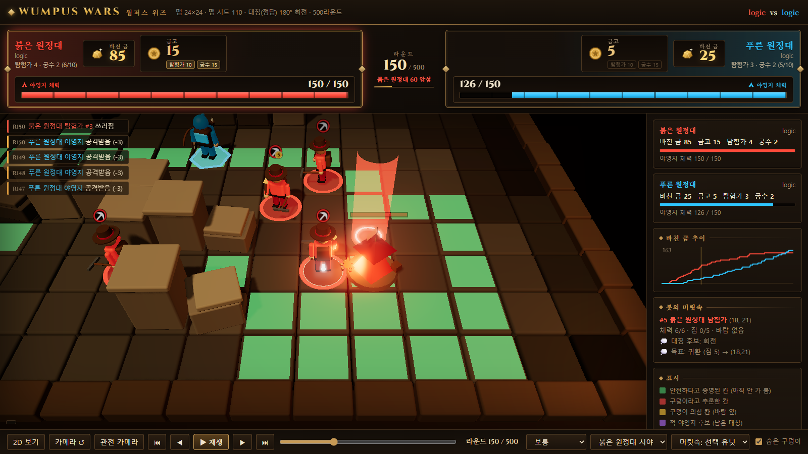

# 봇 API

엔진 코드 (`wumpus/api.py`, `wumpus/engine.py`) 와 한 줄씩 맞춰 쓴 참조 문서다.

## 1. 봇 파일

봇 하나는 폴더 하나다: `bots/<봇이름>/main.py`. 이 파일에 아래 함수가 있어야 한다.

```python
def turn(me, view, memory):
    ...
    return 행동   # Move · Mine · Attack · Spawn 중 하나, 또는 None (쉬기)
```

- 야영지 · 탐험가 · 궁수가 모두 이 함수를 부른다. 종류는 `me.kind` 로 나눈다.
- **유닛마다 파일이 따로 실행된다.** 유닛이 생길 때 파일을 새로 불러 그 유닛 전용 공간에 둔다.
  - 모듈 전역 변수는 그 유닛만의 기억이다. 다른 유닛은 못 보고, 유닛이 죽으면 사라진다.
  - 팀끼리 나눌 정보는 `memory` 로만 주고받는다.
- 파일을 불러오다 오류가 나거나 `turn` 이 없으면, 그 유닛은 경기 내내 아무것도 하지 않는다. `python -m wumpus check 봇` 으로 미리 확인한다.
- 봇은 `main.py` 한 파일로 낸다. 표준 라이브러리 (`math`, `heapq`, `collections`, `random`, `itertools` …) 는 써도 된다.

불러올 것:

```python
from wumpus.api import (Move, Mine, Attack, Spawn, debug,
                        EXPLORER, ARCHER, CAMP,                 # 유닛 종류
                        EMPTY, WALL, GOLD, PIT, CAMP_TILE,      # 칸 종류 '.' '#' 'G' 'P' 'C'
                        DIRS, mirror, cheb, direction_to,       # 도우미
                        COST, HP, CARRY_MAX, MAX_ROUNDS)        # 규칙 수치
```

## 2. 좌표와 방향

- `(x, y)`. x 는 오른쪽, y 는 **아래쪽**으로 커진다. 왼쪽 위가 `(0, 0)`.
- 방향은 네 글자: `'N'` 위 `(0,-1)`, `'E'` 오른쪽 `(1,0)`, `'S'` 아래 `(0,1)`, `'W'` 왼쪽 `(-1,0)`. `DIRS` 사전에 있다.
- 이동은 상하좌우만 된다. 공격은 대각선 칸에도 닿는다.

## 3. `me`: 자기 정보

| 속성 | 뜻 |
|---|---|
| `id` | 유닛 번호. 경기 안에서 겹치지 않는다. 야영지는 1 (붉은), 2 (푸른) |
| `team` | 0 = 붉은 원정대, 1 = 푸른 원정대 |
| `kind` | `CAMP`, `EXPLORER`, `ARCHER` |
| `x`, `y` | 지금 위치 |
| `hp` | 남은 체력 |
| `carry` | 든 금 (탐험가) |
| `round` | 지금 라운드 (1 ~ 500) |
| `bank` | 우리 금고 |

`me` 는 복사본이다. 바꿔도 게임에 영향이 없다.

## 4. `view`: 지금 보고 느끼는 것

### 칸

| 함수 | 돌려주는 값 |
|---|---|
| `view.tile(x, y)` | 보이면 `'.'` 빈 칸 · `'#'` 벽 · `'G'` 금맥 · `'P'` 드러난 구덩이 · `'C'` 야영지. 안 보이면 `None` |
| `view.gold(x, y)` | 보이는 칸의 남은 금 (없으면 0). 안 보이면 `None` |
| `view.visible(x, y)` | 그 칸이 지금 보이는지 |
| `view.visible_cells()` | 지금 보이는 칸 목록 |

- **숨은 구덩이는 `'.'` 로 보인다.** 밟아서 드러난 구덩이만 `'P'` 다.
- 금을 다 캔 칸은 `'.'` 가 된다. 금맥은 다시 자라므로 나중에 다시 `'G'` 가 될 수 있다.
- 유닛이 서 있어도 `tile` 은 땅 종류를 준다 (야영지 칸만 `'C'`).

### 유닛

| 함수 · 속성 | 뜻 |
|---|---|
| `view.units()` | 보이는 유닛 목록 (야영지와 자기 자신 포함, 번호 순) |
| `view.unit_count` | 우리 팀 살아 있는 유닛 수 (야영지 제외) |

목록의 각 유닛은 `id team kind x y hp carry` 를 가진다. 적 유닛도 체력과 든 금이 보인다.

### 감각 · 기타

| 속성 | 뜻 |
|---|---|
| `view.breeze` | 지금 선 칸의 상하좌우 4칸 중에 구덩이가 하나라도 있으면 `True` (야영지는 항상 `False`) |
| `view.my_camp` | 우리 야영지 좌표 `(x, y)` |
| `view.width`, `view.height` | 맵 크기 |
| `view.round`, `view.bank`, `view.score`, `view.team` | 라운드, 우리 금고, 우리 점수 (바친 금 합), 팀 번호 |

### 시야

| 유닛 | 시야 (거리²) | 보이는 칸 |
|---|---|---|
| 탐험가 · 야영지 | 10 | 37칸 |
| 궁수 | 8 | 25칸 |

벽은 시야를 가리지 않는다. 시야는 유닛 하나의 것이다.

## 5. 행동

| 행동 | 누가 | 하는 일 | 무시되는 경우 |
|---|---|---|---|
| `Move(d)` | 탐험가 · 궁수 | `d` 쪽으로 한 칸 | 맵 밖, 벽, 다른 유닛 (아군 · 적 · 야영지) 이 선 칸 |
| `Mine()` | 탐험가 | 선 칸에서 금 1개 | 금이 없는 칸, 이미 5개를 든 경우 |
| `Attack(x, y)` | 궁수 | 그 칸의 적에게 피해 3 | 옆 8칸 밖, 자기 칸, 빈 칸, 아군 |
| `Spawn(kind, d)` | 야영지 | `d` 쪽 옆 칸에 유닛 | 금고 부족, 유닛 10기, 그 칸이 맵 밖 · 벽 · 유닛 |
| `None` | 누구나 | 쉬기 | |

- 안 되는 행동은 **오류 없이 그냥 무시된다.**
- **숨은 구덩이 칸으로 `Move` 하면** 그 유닛은 죽고 구덩이가 드러난다.
- **바침 (행동 아님):** 탐험가가 행동을 마친 뒤 야영지와 상하좌우로 맞닿아 있고 금을 들고 있으면 저절로 다 바친다.
- **야영지 자동 반격 (행동 아님):** 야영지는 자기 차례 끝에 옆 8칸의 적 하나 (체력이 가장 낮은 적, 같으면 번호가 작은 적) 를 저절로 쳐서 피해 1. `Spawn` 과 따로 일어난다.

## 6. `memory`: 팀 공유 메모리

- 정수 64칸 리스트다. 같은 팀 유닛이 모두 같은 리스트를 본다. 처음엔 모두 0.
- 쓴 값은 **바로 다음에 움직이는 유닛**부터 보인다 (같은 라운드 안에서도).
- 차례가 끝날 때마다 64칸으로 맞추고, 값을 32비트 부호 있는 정수 (-2³¹ ~ 2³¹-1) 로 자른다. 정수가 아닌 값은 0 이 된다.
- 상대 팀 메모리는 볼 수 없다.

예: 예시 추론 봇은 `[0]` 지운 대칭 후보 비트, `[1] [2]` 적 야영지 x+1, y+1, `[3]` 만든 궁수 수를 쓴다.

## 7. 디버그 표시: `debug`

뷰어에서 유닛을 누르면 보이는 "봇의 머릿속" 이다. 경기 결과에는 영향이 없고, 차례마다 새로 지워진다.

| 함수 | 뜻 | 한도 (차례마다) |
|---|---|---|
| `debug.mark(x, y, color)` | 칸에 색 칠하기 | 400칸 |
| `debug.path(cells, color)` | 칸 목록을 점선으로 잇기 | 선 8개, 선마다 200칸 |
| `debug.say(text)` | 글 한 줄 | 8줄, 줄마다 200자 |

색: `'green' 'red' 'yellow' 'blue' 'purple' 'white'` 또는 `'#rrggbb'`.



## 8. 도우미

| 함수 | 뜻 |
|---|---|
| `mirror(sym, x, y, w, h)` | 대칭 `sym` (`'H'` 좌우, `'V'` 상하, `'R'` 180° 회전) 으로 옮긴 칸 |
| `cheb(ax, ay, bx, by)` | 체비셰프 거리 (대각선도 1칸) |
| `direction_to(ax, ay, bx, by)` | 맞닿은 두 칸 사이의 방향 글자. 안 맞닿았으면 `None` |
| `DIRS` | `{'N': (0,-1), 'E': (1,0), 'S': (0,1), 'W': (-1,0)}` |

## 9. 오류 · 시간 · 재현성

- `turn` 에서 예외가 나면 그 유닛은 그 차례만 쉰다. 리플레이 사건 목록과 `run` · `scrim` 결과에 오류로 나온다.
- 차례마다 걸린 시간을 잰다 (`run` 출력, 리플레이 `meta.time_ms`). `--time-limit 밀리초` 를 주면 한도를 넘긴 차례의 행동을 버린다.
- `random` 모듈은 차례마다 (경기 시드, 라운드, 유닛 번호) 로 다시 맞춰진다. 같은 봇 · 맵 · 시드면 결과가 같다.

## 10. 가장 작은 봇

```python
from wumpus.api import Move, Mine, Spawn, EXPLORER, CAMP, GOLD

def turn(me, view, memory):
    if me.kind == CAMP:
        return Spawn(EXPLORER, 'E')           # 금고가 되면 탐험가를 만든다
    if view.tile(me.x, me.y) == GOLD:
        return Mine()                          # 금 위면 캔다
    return Move('N')                           # 아니면 위로 (구덩이 조심!)
```
