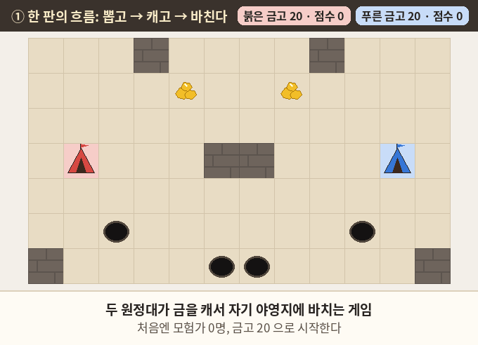
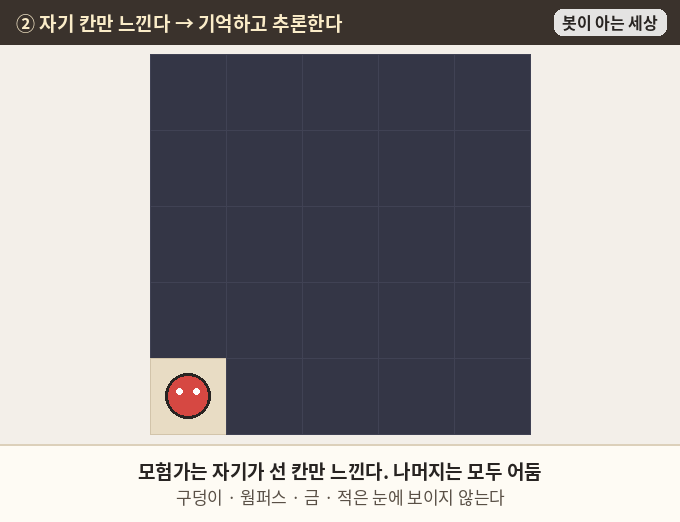
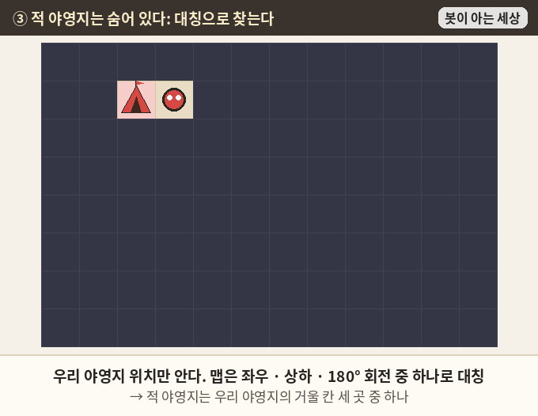
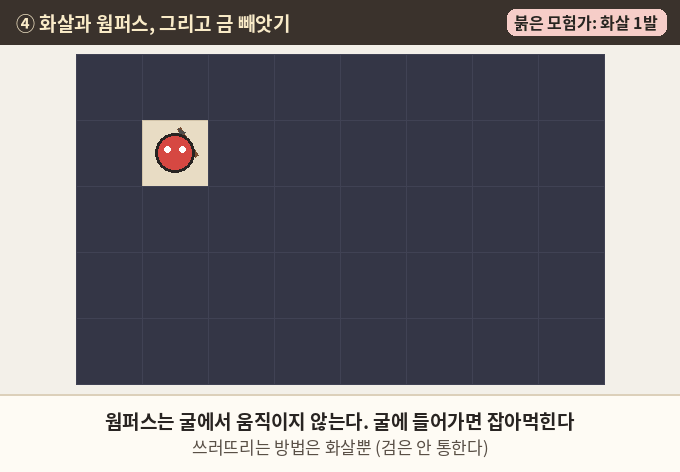

# 웜퍼스 워즈 쉽게 보기

> 수업에서 배운 **웜퍼스 월드**의 에이전트 함수를 짜는 과제다. 차이는 하나, **옆에서 다른 팀도 똑같이 하고 있다**는 것.
> 봇은 `turn(me, view, memory)` 함수 하나다. 지각을 받고, 행동 하나를 돌려준다. 그게 전부다.

## 1. 무엇을 하나: 뽑고 → 캐고 → 바친다



- 두 원정대가 동굴에서 금을 캐 **자기 야영지에 바친다.** 바친 금이 점수다.
- 처음엔 모험가가 없다. 야영지가 **금고 20** 으로 모험가를 뽑는다 (`Spawn`).
- 모험가는 한 차례에 **행동 하나**: 이동 `Move`, 캐기 `Mine`, 검 `Attack`, 화살 `Shoot`.
- 야영지와 맞닿은 칸에서 차례를 마치면 든 금을 **저절로** 바친다.
- **1000 라운드** 뒤 바친 금이 많은 팀 승리. 적 야영지 (체력 150) 를 부수면 바로 승리.

## 2. 보이지 않는 동굴: 느끼고, 기억하고, 추론한다



모험가는 **자기 칸만 느낀다.** 구덩이 · 웜퍼스 · 금 · 적은 보이지 않는다. 교과서 그대로의 추론이 곧 전략이다.

| 지각 | 뜻 |
|---|---|
| 바람 · 악취 | 상하좌우에 구덩이 · 웜퍼스 굴이 있다 (들어가면 죽는다) |
| 반짝임 | 내 칸에 금맥이 있다 |
| 부딪힘 · 발소리 | 지난 이동이 막혔다 · 옆에 다른 모험가가 몇 명 있다 |
| 열기 | 상하좌우에 야영지가 있다 |
| 아픔 · 비명 · 외침 | 내가 맞았다 · 웜퍼스가 쓰러졌다 · 모험가가 쓰러졌다 (맵 전체 개수) |

## 3. 적 야영지는 숨어 있다: 대칭으로 찾는다



맵은 **좌우 · 상하 · 180° 회전** 중 하나로 대칭이다. 그래서 적 야영지는 우리 야영지의 거울 칸 **세 후보** 중 하나다. "대칭이면 벽의 거울 칸도 벽" · "열기가 없으면 옆에 야영지가 없다" 로 후보를 지운다.

## 4. 화살 · 웜퍼스 · 금 빼앗기



- 웜퍼스는 **화살로만** 쓰러진다. 화살은 **한 발**, 일직선으로 날아가 처음 만난 것에 맞는다. 잡으면 보물 **30**.
- 모험가 체력 10. 검은 바로 옆 칸 피해 3, 화살은 피해 6. 화살은 야영지 옆에서 다시 채운다.
- 적을 쓰러뜨리면 **그가 든 금 + 3** 을 빼앗는다. 구덩이 · 웜퍼스에게 죽으면 든 금은 사라진다.

## 5. 봇 = 함수 하나 (실제로 돌아가는 최소 봇)

`bots/mini/main.py` 그대로다. 바람 · 악취가 없던 칸의 옆으로만 걸으므로 **구덩이에 빠지지 않고**, 금 10개를 캐면 왔던 길로 돌아가 바친다.

```python
import random
from wumpus.api import Move, Mine, Spawn, EXPLORER, CAMP, WALL, DIRS, direction_to

path = []          # 야영지 옆에서 지금 칸까지 걸어온 길 (돌아갈 때 쓴다)
seen = set()       # 서 봤거나 막혔던 칸
calm = set()       # 바람도 악취도 없던 칸 (이 칸의 상하좌우는 안전!)
target = None      # 지난 차례에 들어가려던 칸


def turn(me, view, memory):
    global target
    if me.kind == CAMP:                                    # 야영지: 빈 옆 칸에 모험가를 뽑는다
        for d, (dx, dy) in DIRS.items():
            if view.tile(me.x + dx, me.y + dy) not in (None, WALL):
                return Spawn(EXPLORER, d)
        return None

    here = (me.x, me.y)
    if view.bump and target:                               # 막혔다 → 그 칸은 못 가는 칸
        seen.add(target)
    if here in path:
        del path[path.index(here) + 1:]                    # 맴돈 고리는 잘라 낸다
    else:
        path.append(here)
    seen.add(here)
    if not (view.breeze or view.stench):
        calm.add(here)

    if view.glitter and me.carry < 10:                     # 반짝이면 캔다
        return Mine()

    near = [(here[0] + dx, here[1] + dy) for dx, dy in DIRS.values()]
    near = [c for c in near if 0 <= c[0] < view.width and 0 <= c[1] < view.height]
    new = [c for c in near if c not in seen]
    if me.carry >= 10 or here not in calm or not new:      # 짐이 찼거나, 위험하거나, 막다른 곳
        if me.carry < 10 and here in calm:
            new = [c for c in near if c in calm]           # 아는 안전한 칸으로 돌아다닌다
        elif len(path) >= 2:
            new = [path[-2]]                               # 왔던 길로 한 칸 되돌아간다
    if not new:
        return None                                        # 야영지 옆: 금은 저절로 바쳐진다
    target = random.choice(new)
    return Move(direction_to(*here, *target))
```

- **전역 변수 = 그 모험가 혼자의 기억.** 모험가마다 이 파일이 따로 실행된다. 팀과 나눌 것은 `memory` (정수 16칸) 에 적는다.
- 이 봇은 시작용 봇 (`starter`) 에게 진다. **여기서부터 고쳐 나가는 것이 과제다:** 쓰러진 웜퍼스가 80 라운드 뒤 같은 굴에 다시 나타나는 것 기억하기 (이 봇은 가끔 여기서 잡아먹힌다), 바람 두 곳을 엮어 구덩이 찾기, BFS 로 가까운 금 찾기, `memory` 로 금맥 나누기, 대칭으로 적 야영지 찾아 치기.

## 6. 돌려 보기

```bash
python -m wumpus new mybot              # 내 봇 폴더 만들기 (시작용 봇 복사)
python -m wumpus run mini starter --open   # 한 판 + 브라우저 리플레이
python -m wumpus scrim mybot starter    # 맵 10개 · 양쪽 진영으로 승률 보기
python -m wumpus check mybot            # 내기 전에 점검
```

**처음엔 몰라도 되는 것:** 연산 한도 (한 차례 10,000. 이 봇은 많아야 200 정도 쓴다) 와 코드 검사 (`import os` · `type()` · `exec` 같은 것만 안 쓰면 된다) 는 `check` 가 알아서 알려 준다. 자세한 규칙은 [RULES.md](RULES.md), API 는 [API.md](API.md).
