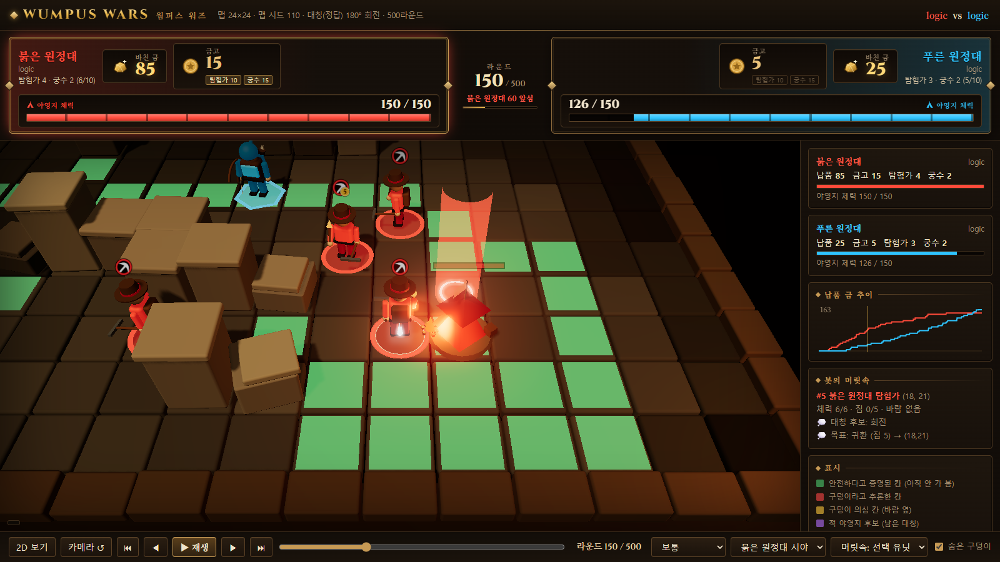

# 시작하기

이 문서를 따라 하면 10분 안에 첫 경기를 보고, 내 봇을 만들어 겨뤄 볼 수 있다.

## 1. 준비

- **Python 3.8 이상**. 다른 패키지는 필요 없다. 확인: `python --version`
- **브라우저** (Chrome · Edge · Firefox). 리플레이를 볼 때 쓴다. 3D 뷰는 인터넷이 있어야 보이고, 없으면 2D 로 보인다.

```bash
git clone <이 저장소 주소> wumpus_wars
cd wumpus_wars
python -m wumpus --help
```

모든 명령은 **저장소 맨 위 폴더 (`wumpus_wars/`)** 에서 친다.

(선택) `pip install -e .` 로 설치하면 어느 폴더에서나 `wumpus` 명령을 쓸 수 있다. 이 문서는 설치 없이 되는 `python -m wumpus` 로 적는다.

> **Windows 에서 한글이 깨지면** 터미널에서 `chcp 65001` 을 한 번 치거나, 환경 변수 `PYTHONUTF8=1` 을 둔다.

## 2. 첫 경기

```bash
python -m wumpus run logic random --open
```

```
맵 temple_gate (24x24, 대칭 H) | 붉은 원정대 (logic) 승리 - 야영지 파괴
라운드 84 | 바친 금 60 : 15 | 0.2초
  붉은 원정대 logic: 차례당 평균 0.27 ms, 최대 4.6 ms
  푸른 원정대 random: 차례당 평균 0.01 ms, 최대 0.0 ms
리플레이: replays/logic-vs-random-temple_gate-s1.json
뷰어    : replays/logic-vs-random-temple_gate-s1.html
```

- 첫 봇이 **붉은 원정대**, 둘째 봇이 **푸른 원정대**다.
- `--open` 을 붙이면 끝나자마자 브라우저에 리플레이가 열린다. 뷰어 사용법은 [리플레이 도구](REPLAY.md) 에 있다.
- 다른 맵: `--map scarab_maze`. 맵 목록은 `python -m wumpus maps`.

## 3. 내 봇 만들기

```bash
python -m wumpus new mybot
```

`bots/mybot/main.py` 가 생긴다. 시작용 봇 (`bots/starter`) 을 복사한 것이다. 이 파일 하나가 봇 전체다.

```python
def turn(me, view, memory):
    if me.kind == CAMP:
        return camp_turn(me, view, memory)       # 야영지: 유닛을 만든다
    if me.kind == EXPLORER:
        return explorer_turn(me, view, memory)   # 탐험가: 금을 캐 나른다
    return archer_turn(me, view, memory)         # 궁수: 싸운다
```

꼭 알아 둘 세 가지:

1. **유닛마다 이 파일이 따로 실행된다.** 모듈 전역 변수는 그 유닛 혼자만의 기억이다.
2. **팀끼리 나눌 것은 `memory` (정수 64칸)** 에 적는다.
3. **유닛은 자기 시야만 본다.** 숨은 구덩이는 눈에 안 보이고, 옆 칸에서 **바람** (`view.breeze`) 으로만 느낀다.

자세한 API 는 [봇 API](API.md), 규칙은 [게임 규칙](RULES.md) 에 있다.

## 4. 고치고 시험하는 순서

```bash
python -m wumpus check mybot                  # 1) 오류 · 시간 점검 (양쪽 진영 한 판씩)
python -m wumpus run mybot random --open      # 2) 한 판을 눈으로 본다
python -m wumpus scrim mybot logic            # 3) 맵 10개 x 양쪽 진영 = 20판으로 실력을 잰다
```



**디버그 표시**: `debug.mark(x, y, 'green')`, `debug.path(칸들)`, `debug.say('글')` 을 부르면, 뷰어에서 그 유닛을 누를 때 봇의 생각이 겹쳐 보인다. 경기 결과에는 영향이 없다. 추론이 맞는지 눈으로 확인하는 가장 빠른 길이다.

고칠 때마다 `scrim` 으로 예전 봇과 겨뤄 보자. 예전 봇은 폴더째 복사해 두면 된다:

```bash
python -m wumpus new mybot_v1 --from mybot     # 지금 봇을 mybot_v1 로 보관
# mybot 을 고친 뒤
python -m wumpus scrim mybot mybot_v1          # 새 봇이 정말 나아졌나?
```

## 5. 더 볼 것

- 예시 추론 봇 `bots/logic/main.py`: 명제논리 · 대칭 추론 · A* 를 쓴다. 일부러 고칠 거리를 남겨 두었다 (CSP 배정, 미니맥스, 여러 바람 칸을 엮는 레졸루션).
- 기본 점검: `python -m unittest discover tests`
