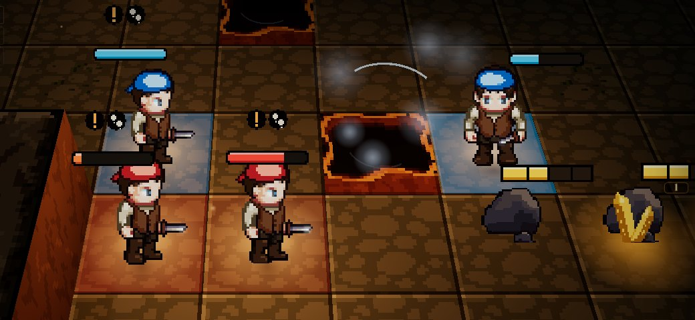

# 리플레이 도구

경기는 끝나면 **리플레이**로 남는다. 리플레이를 뷰어로 열면 경기를 처음부터 끝까지 3D 로 다시 볼 수 있다.

## 1. 리플레이 파일

`run` 을 하면 `replays/` 에 두 파일이 생긴다.

| 파일 | 뜻 |
|---|---|
| `이름.json` | 경기 기록 (모든 라운드의 모험가 · 금 · 사건 · 지각 · debug). 다시 열 수 있다 |
| `이름.html` | 뷰어 + 기록을 한 파일에 담은 것. **브라우저로 바로 열린다.** 다른 사람에게 그대로 보내도 된다 |

```bash
python -m wumpus run mybot starter --open         # 경기 후 바로 뷰어 열기
python -m wumpus view replays/어떤경기.json      # 저장된 .json 을 뷰어로 열기 (.html 을 옆에 만든다)
python -m wumpus viewer                          # 빈 뷰어 (viewer.html). .json 을 창에 끌어다 놓으면 열린다
```

`scrim --save` 로 저장한 리플레이도 같은 방법으로 연다.

## 2. 뷰어 화면


| 부분 | 하는 일 |
|---|---|
| 팀 점수판 (위 양쪽) | 바친 금 (점수), 금고, 모험가 수, 야영지 체력 막대. 값이 바뀌면 `+5` · `-10` 이 잠깐 뜬다 |
| 라운드 (위 가운데) | 지금 라운드 / 1000, 앞선 팀과 점수 차 |
| 경기 화면 | 고정된 각도에서 내려다본 동굴. **끌면 옮기고, 휠로 확대 · 축소**한다. 모험가나 야영지를 누르면 선택된다 |
| 팀 요약 (오른쪽) | 팀마다 바친 금 · 금고 · 모험가 수 · 야영지 체력 |
| 바친 금 추이 | 두 팀의 바친 금 그래프. 세로선이 지금 라운드 |
| 표시 | 화면에 보이는 그림의 뜻. 모험가가 느끼는 지각 아이콘이 먼저, 관전자에게만 보이는 동굴 요소가 나중 |
| 이번 라운드 사건 | 이번 라운드의 공격 · 쓰러짐 · 채굴 · 바침 · 생산 · 웜퍼스 사건 |
| 카메라 ↺ | 카메라를 처음 위치 (맵 전체) 로 |
| 관전 카메라 | 켜면 카메라가 싸움 · 사고가 난 곳을 부드럽게 따라간다. 화면을 끌면 저절로 꺼진다 |
| 소리 · 음량 막대 | 소리 켜기 / 끄기와 음량. 사건이 화면 왼쪽이면 왼쪽에서, 멀리 볼수록 작게 들린다. 동굴 배경음과 발소리도 난다 |
| 재생 단추 · 라운드 막대 · 속도 | 처음 · 한 라운드 뒤 · 재생/정지 · 한 라운드 앞 · 끝, 아무 라운드로 가기, 재생 속도 |
| 시야 | 전체 보기 / 붉은 원정대 시야 / 푸른 원정대 시야 |

### 키보드

| 키 | 하는 일 |
|---|---|
| `Space` | 재생 / 정지 |
| `→` `←` | 한 라운드 앞 / 뒤 |

## 3. 화면에 보이는 것



| 모습 | 뜻 |
|---|---|
| 검을 든 모험가 (팀 색 겉옷 · 목도리) | 모험가. 걷고 베는 도트 캐릭터다. 아주 멀리서 보면 초상화가 든 둥근 패가 된다 |
| 모험가가 선 칸의 옅은 팀 색 빛 | 어느 팀이 그 칸에 서 있는지. 마우스를 올리면 캐릭터 테두리가 팀 색으로 빛난다 |
| 머리 위 도트 막대 | 남은 체력 (30% 이하면 주황) |
| 체력 막대 옆 금화 | 든 금. 숫자가 들고 있는 양이다 (5 면 가득, 밝은 테) |
| **머리 위 작은 아이콘 띠** | 그 모험가가 지금 느끼는 지각: 바람 (하늘색 줄) · 악취 (초록 김) · 반짝임 (금빛 별) · 부딪힘 (주황 !) · 발소리 (발자국) · 아픔 (빨간 하트) |
| 밝은 칸 | 모험가가 느끼는 것은 자기 칸뿐이다. 동굴은 어둡고, 모험가 · 야영지가 선 칸의 바닥만 밝다 (벽 바위는 어렴풋이 보인다) |
| 천막 + 팀 깃발 + 모닥불 | 야영지. 부서지면 검게 탄 천막이 불탄다 |
| 금빛 수정 + 숫자 · 앞의 막대 | 금맥과 남은 금 · 다시 자라는 시계 |
| 바닥에서 솟은 바위 | 벽. 지나갈 수 없다 |
| 바닥이 무너진 검은 구멍 | 구덩이 (관전자에게만 보인다. 봇은 바람으로만 안다) |
| 이끼 낀 돌 골렘 | 웜퍼스. 쓰러지면 해골과 금 상자가 남고, 다시 나타날 때까지 시계가 찬다 |
| 금 주머니 · 금 상자 | 떨어진 금 |
| `-3` · `+1` · `+5` | 피해 · 캐기 · 바침 |

## 4. 팀 시야로 보기

"붉은 원정대 시야" 를 고르면 그 팀이 본 칸만 밝게 보인다. 모험가는 자기 칸만 느끼므로, 봇이 경기 중에 실제로 아는 것이 얼마나 적은지 볼 수 있다. (뷰어는 팀원 모두가 서 본 칸을 합쳐 보여 준다. 봇 하나는 자기 칸만 받는다.)

## 5. 주소로 바로 열기

뷰어 주소 뒤에 `#` 로 시작하는 값을 붙이면 그 장면으로 바로 열린다. 보고서에 장면을 가리킬 때 좋다.

| 값 | 뜻 | 예 |
|---|---|---|
| `r` | 라운드 | `#r=120` |
| `view` | 시야: `all`, `0` (붉은), `1` (푸른) | `&view=0` |
| `sel` | 선택할 번호 | `&sel=5` |
| `cam` | 카메라: 칸 x, 칸 y, 거리 | `&cam=18,21,7` |

예: `replays/경기.html#r=150&view=0&cam=18,21,9`

## 6. 인터넷

- 리플레이 .html 하나에 경기 기록 · 뷰어 · 캐릭터와 동굴 그림 · 3D 라이브러리 (three.js) 가 모두 들어 있다. **인터넷 없이도 열린다.**
- 글꼴만 Google Fonts 에서 불러온다. 인터넷이 없으면 기본 글꼴로 보일 뿐 나머지는 같다.
- 화면은 3D 하나다. 3D 를 띄우려면 브라우저의 WebGL 이 켜져 있어야 한다 (요즘 브라우저는 기본으로 켜져 있다).

## 7. 리플레이 .json 형식 (직접 분석할 때)

```text
{
  "format": "wumpus-replay-1",
  "meta":  { "w", "h", "sym", "map", "names", "teams", "winner", "reason", "rounds", "score",
             "time_ms": [{"avg", "max", "turns", "over"}, ...],
             "ops": [{"avg", "max", "turns", "over"}, ...] },   // 차례당 연산 (max 는 첫 차례를 뺀 최대). 연산 한도를 끈 경기면 null
  "const": { "hp", "cost", "carry", "max_rounds", "rules", "wumpus_hp", ... },
  "map":   { "rows", "ore": [[x, y, 양]], "traps": [[x, y]], "bases": [[x, y], [x, y]], "base_ids": [1, 2],
             "wumpus": [[x, y], ...] },
  "frames": [   // 0 번은 시작 상태, i 번은 라운드 i 가 끝난 상태
    { "u":  [[id, team, 종류('E'/'B'), x, y, hp, 든 금, 바람, -1, 악취, 반짝임, 부딪힘, 발소리], ...],
      "o":  [[x, y, 남은 금], ...],        // 이 라운드에 바뀐 금맥
      "l":  [[x, y, 떨어진 금], ...],      // 바뀔 때만
      "w":  [웜퍼스 체력, ...],
      "bh": [붉은 야영지 체력, 푸른],  "bk": [금고, 금고],  "sc": [바친 금, 바친 금],
      "e":  [사건, ...],                    // 아래 표
      "v":  [붉은 팀 시야, 푸른 팀 시야],    // 칸마다 1비트, 16진 문자열
      "d":  { "id": { "m": 칠한 칸, "l": 경로, "t": 글 } } }
  ]
}
```

| 사건 | 모양 |
|---|---|
| 공격 | `["atk", 공격자 id, 공격자 x, y, 대상 x, y, 대상 id]` (대상 id -1 = 웜퍼스) |
| 부딪힘 | `["bump", id, x, y, 막힌 x, y]` |
| 구덩이 | `["trap", id, x, y]` |
| 죽음 | `["die", id, x, y, "atk" · "trap" · "wumpus" · "roar"]` |
| 채굴 | `["mine", id, x, y, 금맥 x, y]` |
| 줍기 · 떨어짐 | `["pick", id, x, y, 양]` · `["drop", x, y, 양]` |
| 바침 | `["dlv", id, 양, x, y, team]` |
| 생산 | `["spawn", id, team, 종류, x, y]` |
| 웜퍼스 | `["roar", 굴 x, y, [맞은 id]]` (깨어나 친 것) · `["scream", 처치한 id, x, y, team]` · `["eaten", id, x, y]` · `["wrespawn", x, y]` |
| 오류 | `["err", id, 메시지]` (연산 한도 초과도 여기: `연산 한도 초과: ...`) |
