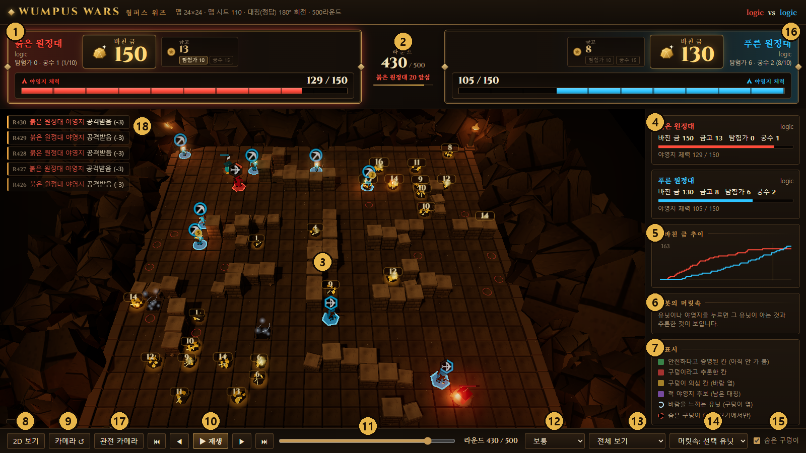
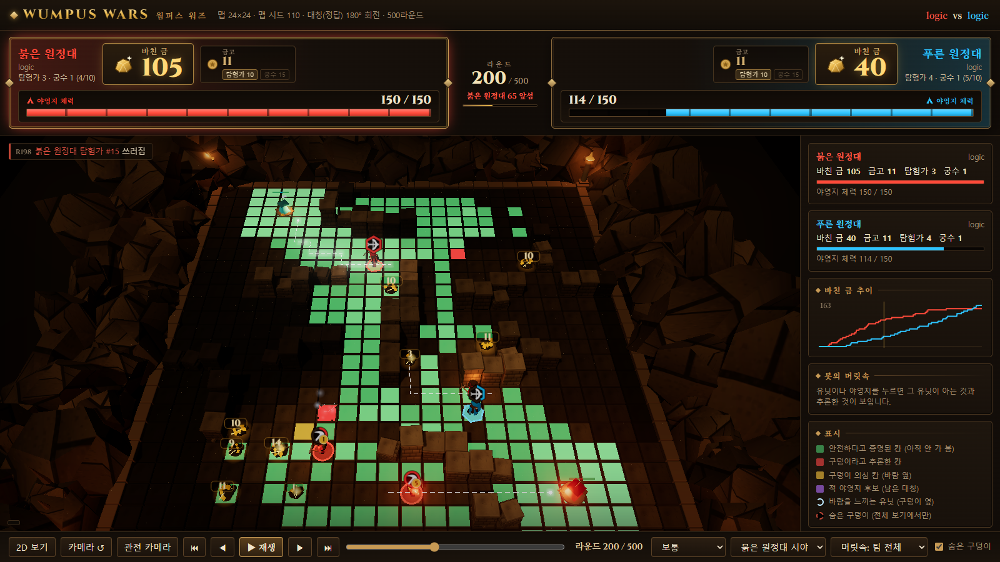
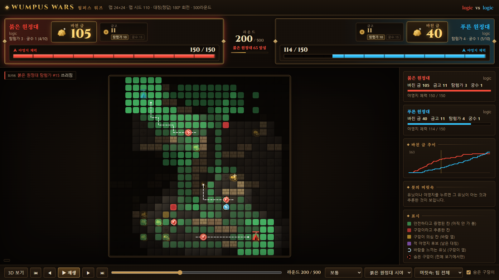

# 리플레이 도구

경기는 끝나면 **리플레이**로 남는다. 리플레이를 뷰어로 열면 경기를 처음부터 끝까지 3D 나 2D 로 다시 볼 수 있다. 봇이 남긴 생각 (`debug`) 까지 겹쳐 보인다.

## 1. 리플레이 파일

`run` 을 하면 `replays/` 에 두 파일이 생긴다.

| 파일 | 뜻 |
|---|---|
| `이름.json` | 경기 기록 (모든 라운드의 유닛 · 금 · 사건 · 시야 · debug). 작고, 다시 열 수 있다 |
| `이름.html` | 뷰어 + 기록을 한 파일에 담은 것. **브라우저로 바로 열린다.** 다른 사람에게 그대로 보내도 된다 |

```bash
python -m wumpus run mybot logic --open          # 경기 후 바로 뷰어 열기
python -m wumpus view replays/어떤경기.json      # 저장된 .json 을 뷰어로 열기 (.html 을 옆에 만든다)
python -m wumpus viewer                          # 빈 뷰어 (viewer.html). .json 을 창에 끌어다 놓으면 열린다
```

`scrim --save` 로 저장한 리플레이도 같은 방법으로 연다.

## 2. 뷰어 화면



| 번호 | 이름 | 하는 일 |
|---|---|---|
| 1, 16 | 팀 점수판 | 바친 금 (점수, 시간 종료 때 승패 기준이라 가장 크게), 금고 (작은 칸), 야영지 체력 막대. 값이 바뀌면 `+5` · `-10` 이 잠깐 뜨고, 야영지가 맞으면 막대가 흔들린다. 금고 아래 `탐험가 10` · `궁수 15` 는 지금 살 수 있으면 켜진다 |
| 2 | 라운드 | 지금 라운드 / 최대 라운드, 앞선 팀과 점수 차 |
| 3 | 경기 화면 | 3D: 끌어서 돌리기, 오른쪽 끌기로 옮기기, 휠로 확대. 유닛이나 야영지를 누르면 선택된다 |
| 4 | 팀 요약 | 팀마다 바친 금 · 금고 · 유닛 수 · 야영지 체력 |
| 5 | 바친 금 추이 | 두 팀의 바친 금 그래프. 세로선이 지금 라운드 |
| 6 | 봇의 머릿속 | 선택한 유닛의 체력 · 짐 · 바람 여부와 `debug.say` 로 남긴 글 |
| 7 | 표시 | 머릿속 색의 뜻 |
| 8 | 2D / 3D | 보기 방식 바꾸기 |
| 9 | 카메라 ↺ | 3D 카메라를 처음 위치로 |
| 10 | 재생 단추 | 처음 · 한 라운드 뒤 · 재생/정지 · 한 라운드 앞 · 끝 |
| 11 | 라운드 막대 | 끌어서 아무 라운드로 간다 |
| 12 | 속도 | 느리게 (초당 1.5 라운드) · 보통 (3) · 빠르게 (6) · 아주 빠르게 (15) |
| 13 | 시야 | 전체 보기 / 붉은 원정대 시야 / 푸른 원정대 시야 |
| 14 | 머릿속 | 선택 유닛만 / 팀 전체 / 끔 |
| 15 | 숨은 구덩이 | 전체 보기에서 숨은 구덩이를 점선 고리로 보일지 |
| 17 | 관전 카메라 | 켜면 3D 카메라가 싸움 · 사고가 난 곳을 부드럽게 따라간다. 화면을 끌면 저절로 꺼진다 |
| 18 | 사건 알림 | 최근 큰 사건 (구덩이 추락 · 쓰러짐 · 야영지 피격) 을 라운드와 함께 몇 줄 보여 준다 |

### 키보드

| 키 | 하는 일 |
|---|---|
| `Space` | 재생 / 정지 |
| `→` `←` | 한 라운드 앞 / 뒤 (짧게 걸어가며 넘어간다) |

재생 중에는 유닛이 라운드 경계에서 멈추지 않고 일정한 속도로 이어 걷는다. 3D 에서는 구덩이 추락 · 처치 · 야영지 피격 때 화면이 잠깐 흔들린다.

## 3. 화면에 보이는 것

| 모습 | 뜻 |
|---|---|
| 동그라미 받침 + 곡괭이 표지 | 탐험가. 표지 오른쪽 아래 금화 숫자 = 든 금 |
| 육각형 받침 + 활 표지 | 궁수 |
| 표지 테두리 고리 | 남은 체력. 12시부터 시계 방향으로 채워지고, 30% 이하면 주황 |
| 천막 + 모닥불 | 야영지 (위에 체력 막대) |
| 금빛 바위 + 숫자 | 금맥과 남은 금 |
| 검은 갱도 | 드러난 구덩이 (바람이 솟는다) |
| 유닛 둘레의 바람 줄기 | 그 유닛이 바람을 느낀다 (옆 칸에 구덩이) |
| 빨간 점선 고리 | 숨은 구덩이 (전체 보기 + "숨은 구덩이" 켬일 때만) |
| 날아가는 화살 | 궁수 공격 또는 야영지 자동 반격 |
| 빛기둥 | 유닛 생산 |
| `+5` | 바침 |

## 4. 팀 시야로 보기



"붉은 원정대 시야" 를 고르면 그 팀 유닛들이 지금 보는 칸만 밝게 보인다. 본 적 있는 칸은 어둡게, 본 적 없는 칸은 까맣게 보인다. 봇이 경기 중에 실제로 아는 것이 얼마나 적은지 느낄 수 있다.

(뷰어는 보기 좋게 팀 시야를 합쳐 보여 준다. 봇 자신은 유닛 하나의 시야만 받는다.)

## 5. 봇의 머릿속 보기 (디버깅)

봇이 `debug.mark` · `debug.path` · `debug.say` 로 남긴 것이 보인다.

1. 시야를 그 팀으로 바꾼다 (선택).
2. 유닛을 누른다. 오른쪽 "봇의 머릿속" 에 글이, 화면에 칠한 칸과 점선 경로가 나온다.
3. "머릿속: 팀 전체" 로 바꾸면 팀 모든 유닛의 표시가 한꺼번에 보인다.



예시 추론 봇의 색 약속:

| 색 | 뜻 |
|---|---|
| 초록 | 안전하다고 증명한 칸 (아직 안 가 봄) |
| 빨강 | 구덩이라고 추론한 칸 |
| 노랑 | 구덩이 의심 칸 (바람 옆) |
| 보라 | 남은 대칭 후보가 가리키는 적 야영지 자리 |
| 흰 점선 | 갈 길 (A*) |

## 6. 주소로 바로 열기

뷰어 주소 뒤에 `#` 로 시작하는 값을 붙이면 그 장면으로 바로 열린다. 보고서에 장면을 가리킬 때 좋다.

| 값 | 뜻 | 예 |
|---|---|---|
| `r` | 라운드 | `#r=120` |
| `view` | 시야: `all`, `0` (붉은), `1` (푸른) | `&view=0` |
| `mind` | 머릿속: `sel`, `team`, `off` | `&mind=team` |
| `sel` | 선택할 유닛 번호 | `&sel=5` |
| `cam` | 3D 카메라: 칸 x, 칸 y, 거리 | `&cam=18,21,7` |
| `mode` | `2d` 면 2D 로 연다 | `&mode=2d` |

예: `replays/경기.html#r=150&view=0&mind=sel&sel=5&cam=18,21,9`

## 7. 3D 와 인터넷

- 3D 뷰는 three.js 를 인터넷 (jsDelivr) 에서 불러온다. 글꼴도 Google Fonts 에서 불러온다.
- 인터넷이 없으면 6초 뒤 저절로 2D 뷰로 바뀐다. 2D 뷰는 인터넷 없이 모든 기능이 된다.

## 8. 리플레이 .json 형식 (직접 분석할 때)

```text
{
  "format": "wumpus-replay-1",
  "meta":  { "w", "h", "sym", "map", "names", "teams", "winner", "reason", "rounds", "score",
             "time_ms": [{"avg", "max", "turns", "over"}, ...] },
  "const": { "hp", "cost", "carry", "max_rounds", "vision" },
  "map":   { "rows", "ore": [[x, y, 양]], "traps": [[x, y]], "bases": [[x, y], [x, y]], "base_ids": [1, 2] },
  "frames": [   // 0 번은 시작 상태, i 번은 라운드 i 가 끝난 상태
    { "u":  [[id, team, 종류('E'/'G'), x, y, hp, 든 금, 바람(0/1)], ...],
      "o":  [[x, y, 남은 금], ...],        // 이 라운드에 바뀐 금맥
      "bh": [붉은 야영지 체력, 푸른],  "bk": [금고, 금고],  "sc": [바친 금, 바친 금],
      "e":  [사건, ...],                    // 아래 표
      "v":  [붉은 팀 시야, 푸른 팀 시야],    // 칸마다 1비트, 16진 문자열
      "d":  { "유닛 id": { "m": 칠한 칸, "l": 경로, "t": 글 } } }
  ]
}
```

| 사건 | 모양 |
|---|---|
| 공격 | `["atk", 공격자 id, 공격자 x, y, 대상 x, y, 대상 id]` |
| 구덩이 | `["trap", id, x, y]` |
| 죽음 | `["die", id, x, y, "atk" 또는 "trap"]` |
| 채굴 | `["mine", id, x, y]` |
| 바침 | `["dlv", id, 양, x, y, team]` |
| 생산 | `["spawn", id, team, 종류, x, y]` |
| 오류 | `["err", id, 메시지]` |

(내부 이름 `ore` · `traps` · `bases` 는 각각 금맥 · 구덩이 · 야영지다.)
