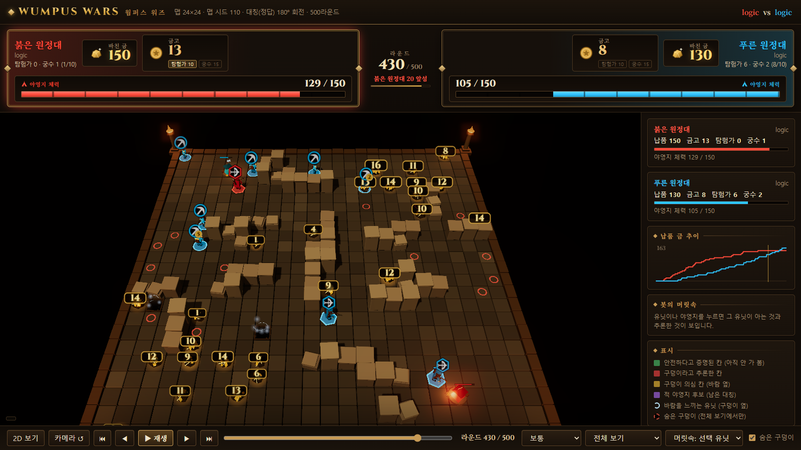
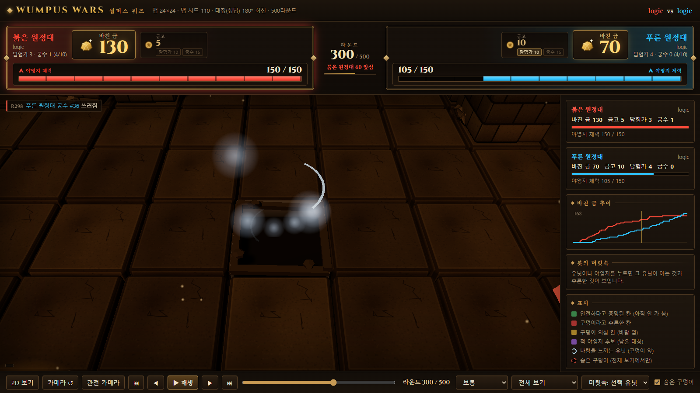
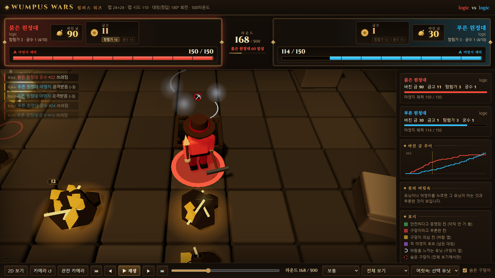
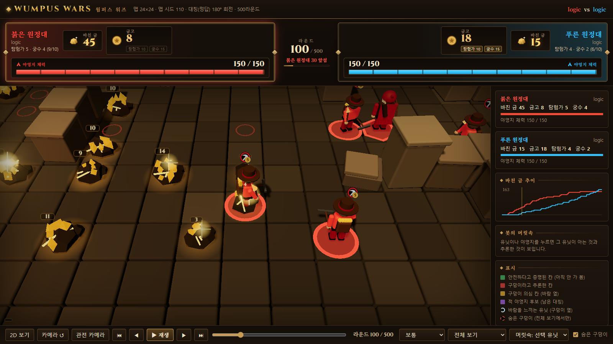
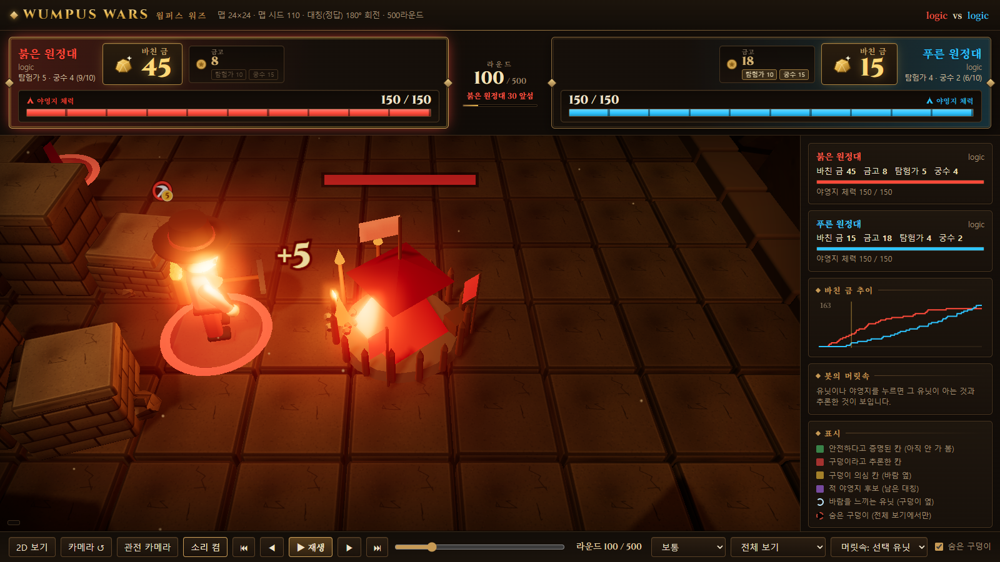
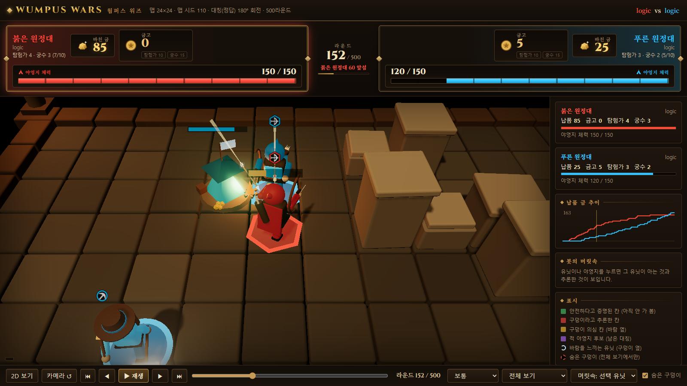

# 게임 규칙

정확한 수치는 모두 `wumpus/api.py` 맨 위에 모여 있다. 이 문서의 표는 그 값과 같다.

## 1. 목표

- 적 **야영지**를 부수면 그 자리에서 이긴다.
- 500라운드가 끝나면 **바친 금**이 많은 쪽이 이긴다. 같으면 야영지 체력, 그것도 같으면 유닛 수로 가린다.

## 2. 맵

- 한 변 20 ~ 28칸 격자다. 칸은 빈 칸, 벽, 금맥, 숨은 구덩이, 야영지 다섯 가지다.
- 맵은 **좌우 대칭 (H), 상하 대칭 (V), 180° 회전 대칭 (R)** 중 하나다. 어느 것인지는 봇에게 알려 주지 않는다. 그래서 처음에는 적 야영지 위치를 모른다.
- 벽, 금맥, 구덩이, 야영지가 모두 같은 대칭을 따른다. 그래서 맵은 양 팀에 공평하다.
- 좌표는 `(x, y)` 이고 x 는 오른쪽, y 는 **아래**로 커진다. 왼쪽 위가 `(0, 0)` 이다.

## 3. 구덩이와 바람

- **숨은 구덩이**는 눈에 보이지 않는다. 봇의 `view.tile` 에는 빈 칸 `'.'` 으로 보인다.
- 구덩이 칸으로 들어간 유닛은 떨어져 **죽는다**. 들고 있던 금도 사라진다. 그 구덩이는 드러나서 `'P'` 로 보인다.
- 구덩이의 **상하좌우 옆 칸**에 선 유닛은 **바람**을 느낀다 (`view.breeze == True`). 어느 쪽인지, 몇 개인지는 알려 주지 않는다. 드러난 구덩이도 바람을 낸다.
- 구덩이는 벽 · 금맥 칸 · 야영지에서 2칸 (체비셰프 거리) 안에는 없다.

수업의 Wumpus 세계와 같다. 예를 들어 "바람이 없는 칸의 상하좌우는 안전하다" 는 규칙으로 안전한 칸을 증명하며 나아갈 수 있다.

## 4. 금맥과 경제

- 금맥 칸에는 금이 8 ~ 16개 있다. 탐험가가 그 칸에 서서 `Mine()` 하면 1개씩 캔다. 한 번에 최대 5개를 든다.
- 금을 든 탐험가가 자기 야영지와 **상하좌우로 맞닿은 칸**에 서면, 그 차례 끝에 저절로 다 **바친다**. 바친 금은 **점수**와 **금고**에 함께 더해진다.
- 금맥은 **12라운드마다 칸마다 1개씩** 처음 양까지 다시 자란다. 다 캔 칸도 다시 자란다.
- 금고는 20 으로 시작하고, 3라운드마다 1씩 저절로 늘어난다. 금고의 금으로 유닛을 만든다. 금고를 써도 점수는 줄지 않는다.

## 5. 유닛

| 유닛 | 비용 | 체력 | 시야 (거리²) | 하는 일 |
|---|---|---|---|---|
| 야영지 | - | 150 | 10 | 옆 칸에 유닛을 만든다. 옆 8칸의 적을 저절로 쳐서 피해 1 (자동 반격) |
| 탐험가 | 10 | 6 | 10 (37칸) | 금을 캐 나른다. 머리 위 표지: 동그라미 안 곡괭이 |
| 궁수 | 15 | 15 | 8 (25칸) | 옆 8칸의 적에게 화살로 피해 3. 머리 위 표지: 육각형 안 활 |

- 팀마다 처음에 탐험가 2기를 갖고 시작한다. 살아 있는 유닛은 팀당 10기까지다 (야영지 빼고).
- 시야는 거리² 로 잰다. `(가로 차이)² + (세로 차이)² ≤ 시야` 인 칸이 보인다. 벽은 시야를 가리지 않는다.
- **유닛마다 자기 시야만 본다.** 팀 유닛들의 시야는 저절로 합쳐지지 않는다.

## 6. 행동

차례마다 행동은 하나다. 안 되는 행동은 오류 없이 무시되고, 그 차례는 쉰 것과 같다.

| 행동 | 누가 | 하는 일 |
|---|---|---|
| `Move(d)` | 탐험가 · 궁수 | 상하좌우 한 칸 (`'N' 'E' 'S' 'W'`). 벽 · 다른 유닛 · 맵 밖으로는 못 간다 |
| `Mine()` | 탐험가 | 선 칸에서 금 1개 캐기 |
| `Attack(x, y)` | 궁수 | 옆 8칸 (대각선 포함) 의 적 하나에 피해 3. 적 야영지도 칠 수 있다 |
| `Spawn(kind, d)` | 야영지 | `d` 쪽 옆 칸에 유닛 만들기 (금고 · 유닛 수 · 빈 칸이 필요) |
| `None` | 누구나 | 쉬기 |

## 7. 차례 순서

1. 라운드가 시작되면 금고 수입 (3라운드마다) 과 금맥 재생 (12라운드마다) 이 먼저 일어난다.
2. 야영지 둘이 움직인다. 홀수 라운드는 붉은 원정대, 짝수 라운드는 푸른 원정대가 먼저다.
3. 유닛들이 **번호 순서대로** 한 번씩 움직인다. 두 팀이 섞여 있다.
4. 각 유닛은 그 순간의 상태를 본다. 앞 유닛이 움직인 결과가 바로 보인다.
5. 이번 라운드에 만든 유닛은 다음 라운드부터 움직인다.

같은 차례 순서 때문에 **먼저 치는 쪽이 유리하다.** 궁수 1기끼리 맞붙으면 먼저 친 쪽이 이긴다.

## 8. 공정성과 재현성

- 같은 봇 · 같은 맵 · 같은 시드면 결과가 항상 같다. 봇의 `random` 모듈은 차례마다 정해진 값으로 다시 맞춰진다.
- 봇이 예외를 던지면 그 차례만 쉬고, 리플레이에 오류로 남는다.
- 차례마다 걸린 시간을 재서 리플레이와 스크림 결과에 보여 준다. `--time-limit` 을 주면 한도를 넘긴 차례의 행동을 버린다.

## 9. 수치 한눈에

| 항목 | 값 | `api.py` 이름 |
|---|---|---|
| 최대 라운드 | 500 | `MAX_ROUNDS` |
| 맵 크기 | 한 변 20 ~ 28 | |
| 시작 금고 · 수입 | 20 · 3라운드마다 +1 | `START_BANK`, `INCOME_EVERY` |
| 금맥 재생 | 12라운드마다 칸마다 +1 (처음 양까지) | `REGROW_EVERY` |
| 유닛 비용 | 탐험가 10, 궁수 15 | `COST` |
| 체력 | 탐험가 6, 궁수 15, 야영지 150 | `HP` |
| 시야 (거리²) | 탐험가 10, 궁수 8, 야영지 10 | `VISION_R2` |
| 궁수 공격 | 3 | `ATTACK_DAMAGE` |
| 야영지 자동 반격 | 1 | `CAMP_ATTACK` |
| 운반 한도 | 5 | `CARRY_MAX` |
| 유닛 한도 | 팀당 10 | `MAX_UNITS` |
| 공유 메모리 | 32비트 정수 64칸 | `MEMORY_SIZE` |
| 구덩이 없는 거리 | 야영지에서 2칸 안 | `SAFE_RADIUS` |

## 시안 규칙 (fun-rules 브랜치, 시험 중)

탐험가가 궁수를 만나면 아무것도 못 하고 쓰러지는 장면과, 한 종류만 남으면 볼거리가 없는 문제를 줄이려는 규칙이다. 교과서 Wumpus 세계의 화살 · 악취 · 비명을 가져왔다. 엔진의 `RULES` 스위치로 하나씩 켜고 끌 수 있다.

| 규칙 | 내용 |
|---|---|
| 직선 화살 | 궁수는 `Shoot(d)` 로 상하좌우 한 방향에 쏜다. 화살은 5칸까지 날아가 처음 만난 유닛 · 야영지 · 웜퍼스에 3 피해. 우리 편이 있으면 막히고, 벽에서 멈춘다. `Attack(x, y)` 는 같은 줄 · 같은 열이면 그쪽으로 쏜 것과 같다 |
| 화살 3발 | 궁수는 화살 3발을 든다. 차례 끝에 우리 야영지 옆 8칸에 있으면 다시 가득 찬다. 바로 옆 (상하좌우) 의 적 야영지는 화살 없이 횃불로 태운다 (3 피해) |
| 화살이 떨어진 궁수 | 빗나간 화살은 멈춘 칸에 떨어지고 (맞힌 화살은 부러짐), 궁수가 그 칸에서 `Mine()` 하면 줍는다. 쓰러진 궁수의 남은 화살도 떨어진다. 화살이 없으면 `Shoot(d)` 는 바로 옆 (상하좌우) 적을 단검으로 찌른다 (1 피해) |
| 밀치기 | 탐험가는 `Push(d)` 로 옆의 적 유닛을 한 칸 민다. 피해는 없지만 밀린 칸이 구덩이나 웜퍼스 굴이면 죽는다. 밀릴 칸이 벽 · 유닛 · 맵 밖이면 그대로 |
| 떨어진 금 | 쓰러진 유닛의 짐은 그 칸에 떨어진다 (구덩이에 떨어지면 함께 사라짐). `Mine()` 으로 먼저 줍는다. 궁수도 2개까지 주워 바칠 수 있다 |
| 웜퍼스 | 맵 가운데 (대칭 짝) 굴에 웜퍼스가 산다. 보이지 않고, 상하좌우 이웃에서 악취 (`view.stench`) 가 난다. 굴로 들어가면 잡아먹힌다. 화살 3발 (체력 9) 이면 쓰러지고, 비명 (`view.screams`) 이 모두에게 들리며, 굴에 보물 금 20이 떨어진다 |

굴은 두 야영지에서 체비셰프 5 밖, 벽 · 구덩이 · 금맥과 구덩이 옆이 아닌 칸 중 맵 가운데에 가장 가깝다.

## 시안 2: 누구나 캐고 싸운다 (fun-rules 브랜치, 시험 중)

규칙 스위치 `unified` 를 켜면 (지금 기본값) 시안 1 의 화살 수 · 화살 줍기 · 단검 · 직선 화살이 꺼지고 아래 규칙이 된다.

| | 값 | 체력 | 한 턴에 | 공격 | 들 수 있는 금 |
|---|---|---|---|---|---|
| 광부 (탐험가) | 10 | 12 | 이동 1번 + 행동 1번 | 상하좌우 바로 옆, 피해 3 | 5 |
| 궁수 | 15 | 8 | 이동 또는 행동 1번 | 맨해튼 거리 3 안, 피해 3 | 2 |

- 광부의 행동은 공격 · 캐기 · 줍기 · 밀치기 중 하나다. 봇은 `return Move('E'), Attack(x, y)` 처럼 둘을 함께 돌려준다 (이동이 먼저).
- 궁수 화살은 두 칸 중심을 잇는 선이 벽 칸을 지나면 막힌다 (`api.sight_cells`). 아군은 막지 않는다.
- 야영지는 누구든 바로 옆 (상하좌우) 에서만 칠 수 있다.
- 누구나 금맥을 캐고 떨어진 금을 줍는다. 쓰러지면 든 금을 모두 그 칸에 떨어뜨린다 (구덩이면 사라짐).
- 밀치기 · 웜퍼스 · 악취는 시안 1 과 같다. 웜퍼스는 공격 사거리 안이면 누구나 칠 수 있다.
