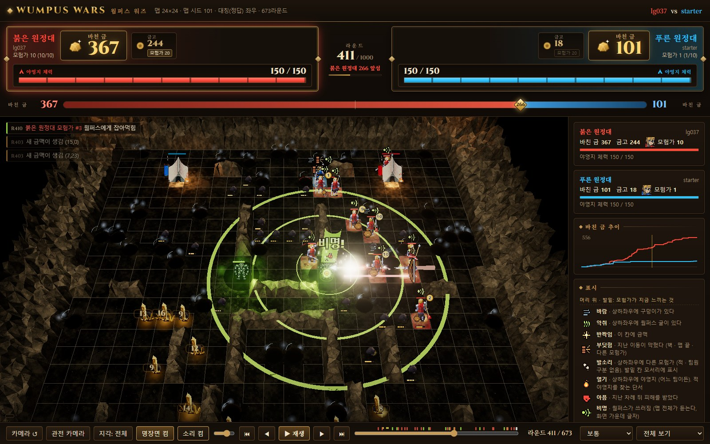
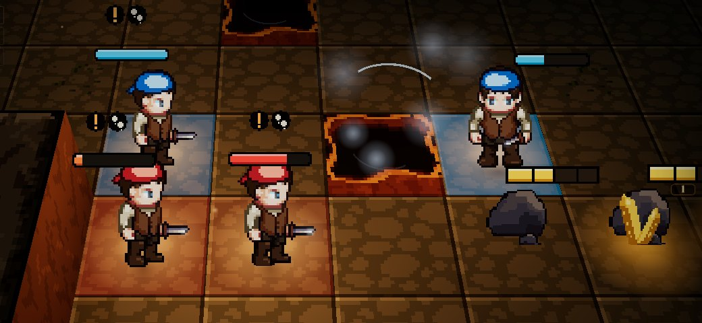
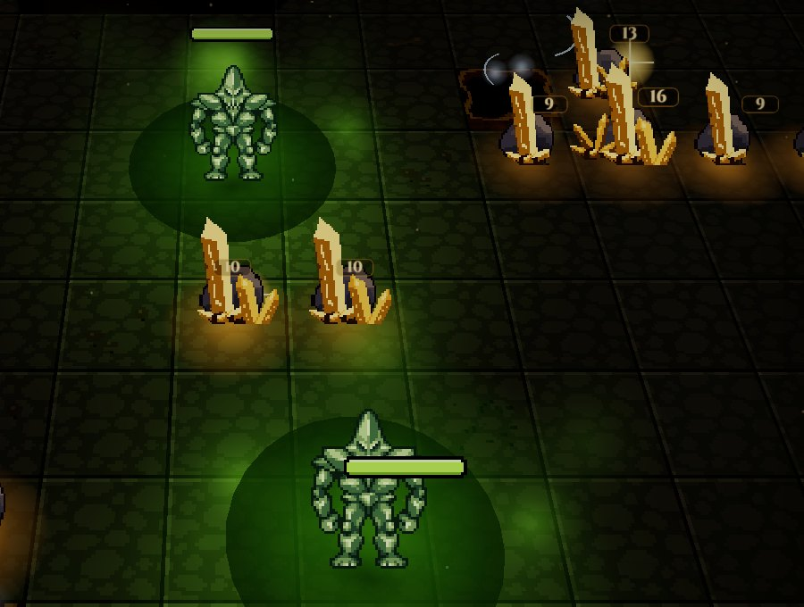
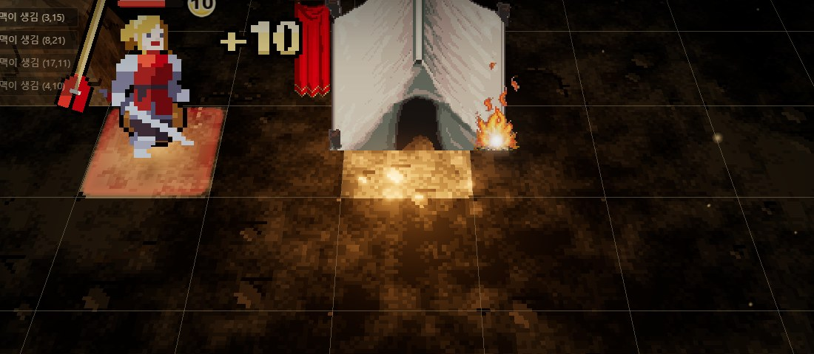

# 게임 규칙

웜퍼스 워즈는 수업의 **웜퍼스 월드**를 두 팀이 겨루는 게임으로 바꾼 것이다. 모험가는 자기 칸만 느끼고, 나머지는 모두 **기억과 추론**으로 알아내야 한다. 정확한 수치는 모두 `wumpus/api.py` 맨 위에 모여 있고, 이 문서의 표는 그 값과 같다.

## 1. 목표

- 적 **야영지**를 부수면 그 자리에서 이긴다.
- **1000 라운드**가 끝나면 **바친 금**이 많은 쪽이 이긴다. 같으면 야영지 체력, 그것도 같으면 모험가 수로 가린다.

## 2. 맵

- 한 변 20 ~ 28칸 격자다. 칸은 빈 칸, 벽, 금맥, 구덩이, 웜퍼스 굴, 야영지 여섯 가지다.
- 맵은 **좌우 (H) · 상하 (V) · 180° 회전 (R)** 대칭 중 하나다. 벽 · 금맥 · 구덩이 · 굴 · 야영지가 모두 같은 대칭을 따르므로 양 팀에 공평하다. 어느 대칭인지는 알려 주지 않는다.
- 좌표는 `(x, y)` 이고 x 는 오른쪽, y 는 **아래**로 커진다. 왼쪽 위가 `(0, 0)` 이다.
- 두 **야영지의 위치는 모두가 안다** (`view.my_camp`, `view.enemy_camp`). 나머지는 아무것도 알려 주지 않는다.

## 3. 모험가

| 항목 | 값 |
|---|---|
| 비용 | 금고 10 |
| 체력 | 10 |
| 검 피해 | 3 (상하좌우 옆 칸만) |
| 들 수 있는 금 | 5 |
| 한 턴에 | **이동 또는 공격 하나** |

- 유닛은 모험가 한 가지뿐이다. 팀마다 모험가 2명으로 시작하고, 살아 있는 모험가는 팀당 10명까지다.
- 모험가는 **자기 칸만 느낀다.** 옆 칸의 벽 · 구덩이 · 금 · 웜퍼스 · 다른 모험가는 보이지 않는다.

## 4. 지각

모험가는 차례마다 자기 칸에서 아래 일곱 가지를 느낀다. 교과서 웜퍼스 월드의 다섯 지각 (악취 · 바람 · 반짝임 · 부딪힘 · 비명) 에 두 팀 게임을 위한 둘 (발소리 · 아픔) 을 더했다.

| 지각 | 언제 느끼나 | 알려 주지 않는 것 |
|---|---|---|
| **바람** | 상하좌우 칸 중에 구덩이가 있다 | 어느 쪽인지, 몇 개인지 |
| **악취** | 상하좌우 칸 중에 살아 있는 웜퍼스 굴이 있다 | 어느 쪽인지 |
| **반짝임** | 이 칸에 금맥이나 떨어진 금이 있다 | 옆 칸의 금 |
| **부딪힘** | 지난 이동이 막혔다 (벽 · 맵 끝 · 다른 모험가 · 야영지) | 무엇에 막혔는지 |
| **발소리** | 상하좌우의 다른 모험가 수 (팀 구분 없음) | 어느 쪽인지, 적인지 팀원인지 |
| **아픔** | 지난 차례 뒤 받은 피해 | 누가, 어디서 쳤는지 |
| **비명** | 지금까지 쓰러진 웜퍼스 수 (맵 어디서든) | 어느 굴인지 |

예: "바람도 악취도 없는 칸의 상하좌우는 안전하다", "발소리 2 인데 옆에 팀원이 하나라고 기억하면, 남은 하나는 적이다".

## 5. 구덩이

- 구덩이에 들어간 모험가는 떨어져 **죽는다.** 들고 있던 금도 함께 사라진다.
- 누가 떨어져도 구덩이는 **끝까지 보이지 않는다.** 바람으로만 알 수 있다.
- 두 야영지에서 2칸 (체비셰프 거리) 안에는 구덩이가 없다. 벽 · 금맥 칸에도 없다.

## 6. 웜퍼스

| 항목 | 값 |
|---|---|
| 체력 | 9 (검 3번) |
| 평소 | **잠들어 있다.** 굴에 들어간 모험가만 잡아먹는다. 악취를 느끼는 옆 칸은 안전하다 |
| 공격받으면 | **깨어나** 5 라운드 동안, 매 라운드 끝에 상하좌우 옆의 한 명에게 피해 6. 그 라운드에 자기를 친 모험가를 먼저 노린다 |
| 회복 | 그 라운드에 맞지 않으면 체력 +1 |
| 쓰러지면 | 굴에 금 20 이 떨어진다 (밟는 모험가가 줍는다). 모두가 비명을 듣는다 |
| 다시 나타남 | 쓰러지고 80 라운드 뒤, 굴이 비어 있으면 |

- 굴은 맵 가운데 가까이, 대칭 짝으로 한두 곳이다. 야영지에서 체비셰프 거리 5 안에는 없다.

## 7. 금

- 금맥 칸에는 금이 8 ~ 16개 있다. 그 칸에 서서 `Mine()` 하면 1개씩 캔다.
- 금맥은 **12 라운드마다 칸마다 1개씩** 처음 양까지 다시 자란다. 다 캔 칸도 다시 자란다.
- 쓰러진 모험가는 든 금을 그 칸에 떨어뜨린다 (구덩이에 빠지면 사라진다). 떨어진 금은 그 칸에 **들어서면 저절로** 줍는다.
- 금을 든 모험가가 자기 야영지와 **상하좌우로 맞닿은 칸**에서 차례를 마치면 저절로 다 **바친다.** 바친 금은 점수와 금고에 함께 더해진다.
- 금고는 20 으로 시작하고, 3 라운드마다 1씩 저절로 늘어난다. 금고로 모험가를 만든다 (점수는 줄지 않는다).

## 8. 야영지

- 체력 150. 바로 옆 (상하좌우) 의 적 모험가만 칠 수 있다.
- 차례마다 상하좌우 옆 칸에 모험가를 하나 만들 수 있다 (`Spawn`). 야영지는 생산 자리를 고르려고 **상하좌우 옆 칸까지** 본다.
- 자기 차례 끝에 옆 8칸 (대각선 포함) 의 적 하나를 저절로 쳐서 피해 1 (자동 반격).

## 9. 행동

차례마다 행동은 하나다. 안 되는 행동은 오류 없이 무시되고, 그 차례는 쉰 것과 같다.

| 행동 | 누가 | 하는 일 |
|---|---|---|
| `Move(d)` | 모험가 | 상하좌우 한 칸 (`'N' 'E' 'S' 'W'`). 막히면 움직이지 않고 다음 차례에 부딪힘을 느낀다 |
| `Mine()` | 모험가 | 선 칸의 금맥에서 금 1개 |
| `Attack(x, y)` | 모험가 | 상하좌우 옆 칸을 검으로 친다. 적 모험가 · 적 야영지 · 웜퍼스면 피해 3, 빈 칸이면 헛친다 |
| `Spawn(EXPLORER, d)` | 야영지 | `d` 쪽 옆 칸에 모험가 (금고 10 · 팀 10명 미만 · 빈 칸) |
| `None` | 누구나 | 쉬기 |

## 10. 차례 순서

1. 라운드가 시작되면 금고 수입 (3 라운드마다) 과 금맥 재생 (12 라운드마다) 이 먼저 일어난다.
2. 야영지 둘이 움직인다. 홀수 라운드는 붉은 원정대, 짝수 라운드는 푸른 원정대가 먼저다.
3. 모험가들이 **번호 순서대로** 한 번씩 움직인다. 두 팀이 섞여 있다. 앞 모험가가 움직인 결과가 바로 반영된다.
4. 라운드 끝에 깨어 있는 웜퍼스가 친다. 쓰러진 웜퍼스가 다시 나타날 때가 되면 나타난다.
5. 이번 라운드에 만든 모험가는 다음 라운드부터 움직인다.

## 11. 연산 한도

봇이 너무 오래 계산하면 경기가 끝나지 않는다. 그래서 **봇 코드가 한 일의 양 (연산)** 을 세어 한도를 둔다 (배틀코드의 바이트코드 한도와 같은 생각). 시간이 아니라 일의 양을 세므로, 같은 봇 · 맵 · 시드면 컴퓨터가 달라도 결과가 같다.

| 항목 | 값 | `api.py` 이름 |
|---|---|---|
| 유닛마다 한 차례에 쓸 수 있는 연산 | 10,000 | `OPS_TURN` |
| 유닛의 첫 차례 (봇 파일 불러오기 + 첫 `turn`) | 200,000 | `OPS_FIRST` |
| 시간 안전망 (한 차례) | 1,000 ms | `TIME_SAFETY_MS` |

- **유닛마다 따로, 차례마다 새로.** 야영지와 모험가 하나하나가 차례마다 10,000 을 받는다. 덜 써도 **쌓이지 않고**, 다른 유닛이 많이 써도 내 몫은 줄지 않는다.
- **첫 차례는 넉넉하다.** 유닛이 태어나 봇 파일을 불러올 때 (모듈 맨 위 코드) 와 첫 `turn` 호출을 합쳐 200,000 까지 쓴다. 표 만들기 같은 준비 계산은 여기서 한다.
- **연산 1 로 세는 것** (봇 파일의 코드와, 봇이 부른 API 함수 `view.*` · `me` · `wumpus.api` 안에서):
  - 줄 하나를 실행하기 시작할 때
  - 반복이 한 번 되돌아갈 때 (`for` · `while` · 컴프리헨션)
  - 함수 · 람다 · 제너레이터가 한 번 시작되거나 다시 이어질 때

  그래서 `for i in r: t += i` 나 `[f(x) for x in xs]`, `sum(g(x) for x in xs)`, `sorted(xs, key=lambda …)` 처럼 **한 줄에 몰아 쓴 반복도 도는 만큼 센다.** 여러 줄로 풀어 쓴 코드와 크게 다르지 않다.
- **세지 않는 것:** `len` · `sorted` · `heapq` 같은 내장 함수의 안쪽 (부른 줄만 센다). 이 틈은 아래 둘이 막는다.
  - **허용 모듈:** 봇은 `math` · `heapq` · `collections` · `itertools` · `functools` · `random` · `bisect` · `operator` · `copy` · `wumpus.api` 만 불러올 수 있다. `exec` · `eval` · `compile` · `open` · `input` 은 쓸 수 없다.
  - **시간 안전망:** 한 차례가 1초를 넘으면 그 차례의 행동을 버린다. 한도 안의 봇은 한 차례가 수 ms 라 닿을 일이 없다. 내장 함수에 아주 큰 일을 넘기는 코드만 걸린다.
- **넘으면:** 한도에 닿는 그 자리에서 차례가 끊기고, 그 차례의 행동은 버려진다 (쉰 것과 같다). 리플레이에 오류로 남는다.
- 끊길 때 나는 예외는 `Exception` 이 아니므로 `except Exception:` 으로 잡히지 않는다. `except:` 로 잡아도 다음 줄에서 다시 끊긴다.
- 이번 차례에 남은 연산은 `ops_left()` 로, 이번 차례의 한도는 `me.ops_limit` 으로 볼 수 있다. 결정은 남은 양이 아니라 직접 센 일의 양 (탐색 칸 수 상한 등) 으로 가르는 것을 권한다 ([API 9절](API.md)).
- 공식 셈은 Python 3.12 이상 기준이다 (그 아래 버전은 다른 방식으로 세어 값이 조금 다를 수 있다).

이 한도는 일반 컴퓨터 (4코어) 에서 학생 40명이 한 시간에 6판씩 겨루고, 교수님이 1시간 반 안에 모두를 여러 맵에서 채점할 수 있게 정했다. 보통 봇끼리는 한 판이 몇 초이고, 두 팀의 모든 유닛이 매 차례 한도를 꽉 채우는 극단에서도 일반 컴퓨터에서 1분쯤이다.

## 12. 팀 공유 메모리

- 팀마다 32비트 정수 16칸 (512비트) 을 함께 쓴다. 모험가끼리 정보를 나누는 방법은 이것뿐이다.
- 맵 한 칸에 1비트도 안 된다. 맵 전체를 나눌 수 없으므로, 무엇을 나눌지 고르는 것도 봇의 판단이다.
- 모험가 하나의 기억 (봇 파일의 전역 변수) 은 그 모험가가 살아 있는 동안 남고, 크기 제한이 없다.

## 13. 공정성과 재현성

- 같은 봇 · 같은 맵 · 같은 시드면 결과가 항상 같다. 봇의 `random` 모듈은 차례마다 정해진 값으로 다시 맞춰진다.
- 봇이 예외를 던지면 그 차례만 쉬고, 리플레이에 오류로 남는다.
- 연산 한도 (11절) 를 넘긴 차례는 행동을 버린다. 차례마다 걸린 시간도 잰다. 한 차례가 1초 (시간 안전망) 를 넘으면 그 차례의 행동도 버린다. `--time-limit` 으로 이 값을 바꿀 수 있다.

## 14. 수치 한눈에

| 항목 | 값 | `api.py` 이름 |
|---|---|---|
| 최대 라운드 | 1000 | `MAX_ROUNDS` |
| 시작 금고 · 수입 | 20 · 3 라운드마다 +1 | `START_BANK`, `INCOME_EVERY` |
| 금맥 재생 | 12 라운드마다 칸마다 +1 | `REGROW_EVERY` |
| 모험가 비용 · 체력 · 운반 | 10 · 10 · 5 | `COST`, `AGENT_HP`, `AGENT_CARRY` |
| 검 피해 | 3 | `ATTACK_DAMAGE` |
| 야영지 체력 · 자동 반격 | 150 · 1 | `HP`, `CAMP_ATTACK` |
| 웜퍼스 체력 · 일격 · 깨어 있는 시간 | 9 · 6 · 5 라운드 | `WUMPUS_HP_A`, `WUMPUS_STRIKE_A`, `WUMPUS_WAKE_A` |
| 웜퍼스 보물 · 다시 나타남 | 20 · 80 라운드 | `WUMPUS_HOARD_A`, `WUMPUS_RESPAWN` |
| 팀 모험가 한도 | 10 | `MAX_UNITS` |
| 공유 메모리 | 32비트 정수 16칸 (512비트) | `MEMORY_SIZE` |
| 연산 한도: 유닛의 한 차례 · 첫 차례 | 10,000 · 200,000 | `OPS_TURN`, `OPS_FIRST` |
| 시간 안전망 (한 차례) | 1,000 ms | `TIME_SAFETY_MS` |
